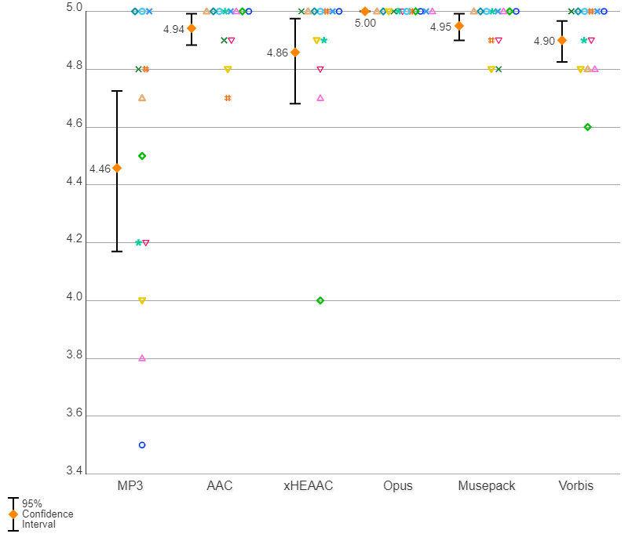

# Personal Blind Test: MultiCodec at ~192 kbps VBR

> Mirror of the Hydrogenaudio thread: https://hydrogenaudio.org/index.php/topic,120007.0.html

Hello, Everyone! :)

It's my personal blind test – MultiCodec at ~192 VBR kbps.

## Encoders

All versions of encoders were the newest and stable:

- LAME MP3 3.100 `-V2` (~192 kbps)
- Apple LC-AAC 7.10.9.0 via QAAC TVBR `q91` (~192 kbps)
- xHE-AAC 1.0.7.0 `-m 9` (~192 kbps)
- Opus 1.3.1 `-b 182` (yes, 182, not 192 kbps; that's why Opus stays on par with all other encoders during bitrate verification on a big number of albums)
- Musepack (MPC Encoder 1.30.0 `--stable`) `Q5.5` (~192 kbps)
- Vorbis aoTuV "OGG" 6.03 `-q6` (~192 kbps)

### Sampling rate treatment for Opus codec (44.1/48 kHz)

- **Encoding:** Original .WAV 44.1 kHz → foobar2000's dBpoweramp SSRC resampling 48 kHz (on-the-fly feed) → Opus file 48 kHz
- **Decoding:** Opus file 48 kHz → SSRC 44.1 kHz .WAV

## Hardware

- **Source:** Benchmark DAC1 with built-in headphone amp HPA2 (24 bit/44.1 kHz mode)
- **Headphones:** Sennheiser HD 800

## Files

All test files (source FLACs, per-codec encodes, ABC/HR notes, and result graphs) are in this repository.

## Results

| ~192 kbps | Score |
|---|---|
| Opus | 5.00 (fully transparent) |
| Musepack | 4.95 |
| Apple LC-AAC | 4.94 |
| Vorbis aoTuV "OGG" | 4.90 |
| xHE-AAC | 4.86 |
| LAME MP3 | 4.46 |

### Alternative graph of the results

## Conclusions

... empty spaces...
